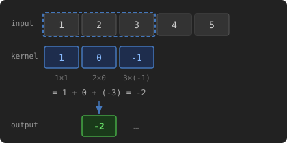

# 1D Convolution

LeetGPU · #9

[打开实现文件](../../practice/leetgpu/9/solution.cu) · [原始材料](../../references/LeetGPU/challenges/easy/9_1d_convolution/challenge.html)

Implement a program that performs a 1D convolution operation. Given an input array and a kernel (filter), compute the convolved output. The convolution should be performed with a "valid" boundary condition, meaning the kernel is only applied where it fully overlaps with the input.

 The input consists of two arrays:

- `input`: A 1D array of 32-bit floating-point numbers.

- `kernel`: A 1D array of 32-bit floating-point numbers representing the convolution kernel.

 The output should be written to the `output` array, which will have a size of `input_size - kernel_size + 1`.

 The convolution operation is defined mathematically as:
 \[ output[i] = \sum_{j=0}^{kernel\_size-1} input[i + j] \cdot kernel[j] \]
 where \(i\) ranges from 0 to \(input\_size - kernel\_size\).

## Implementation Requirements

- Use only native features (external libraries are not permitted)

- The `solve` function signature must remain unchanged

- The final result must be stored in the array `output`

## Example 1:

~~~text

Input: input = [1, 2, 3, 4, 5], kernel = [1, 0, -1]
Output: [-2, -2, -2]

~~~

## Example 2:

~~~text

Input: input = [2, 4, 6, 8], kernel = [0.5, 0.2]
Output: [1.8, 3.2, 4.6]

~~~

## Constraints

- 1 ≤ `input_size` ≤ 1,500,000

- 1 ≤ `kernel_size` ≤ 2047

- `kernel_size` ≤ `input_size`

- Performance is measured with `input_size` = 1,500,000, `kernel_size` = 2,047

## 本地接口

~~~cpp
extern "C" void solve(const float* input, const float* kernel, float* output, int input_size,
                      int kernel_size);
~~~

## 本地用例

~~~bash
./practice.sh cases leetgpu 9
./practice.sh test leetgpu 9
~~~

展开输入规格

~~~text
  #0 公开样例 · input (5,) float32 · kernel (3,) float32 · output (3,) float32 · input_size 5 · kernel_size 3
  #1 公开功能用例 · input (5,) float32 · kernel (3,) float32 · output (3,) float32 · input_size 5 · kernel_size 3
  #2 公开功能用例 · input (4,) float32 · kernel (2,) float32 · output (3,) float32 · input_size 4 · kernel_size 2
  #3 公开功能用例 · input (4,) float32 · kernel (1,) float32 · output (4,) float32 · input_size 4 · kernel_size 1
  #4 公开功能用例 · input (6,) float32 · kernel (2,) float32 · output (5,) float32 · input_size 6 · kernel_size 2
  #5 公开功能用例 · input (5,) float32 · kernel (3,) float32 · output (3,) float32 · input_size 5 · kernel_size 3
  #6 公开功能用例 · input (10,) float32 · kernel (3,) float32 · output (8,) float32 · input_size 10 · kernel_size 3
  #7 公开功能用例 · input (100,) float32 · kernel (7,) float32 · output (94,) float32 · input_size 100 · kernel_size 7
  #8 公开功能用例 · input (1000,) float32 · kernel (15,) float32 · output (986,) float32 · input_size 1000 · kernel_size 15
  #9 公开功能用例 · input (50,) float32 · kernel (20,) float32 · output (31,) float32 · input_size 50 · kernel_size 20
  #10 公开功能用例 · input (200,) float32 · kernel (2,) float32 · output (199,) float32 · input_size 200 · kernel_size 2
  #11 公开功能用例 · input (1,) float32 · kernel (1,) float32 · output (1,) float32 · input_size 1 · kernel_size 1
  #12 公开功能用例 · input (10,) float32 · kernel (10,) float32 · output (1,) float32 · input_size 10 · kernel_size 10
  #13 公开功能用例 · input (10000,) float32 · kernel (3,) float32 · output (9998,) float32 · input_size 10000 · kernel_size 3
  #14 首个用例复验 · 原用例 #1 · 种子 2040 · 缓冲区守卫 · input (5,) float32 · kernel (3,) float32 · output (3,) float32 · input_size 5 · kernel_size 3
  #15 中间用例复验 · 原用例 #7 · 种子 2041 · 缓冲区守卫 · input (100,) float32 · kernel (7,) float32 · output (94,) float32 · input_size 100 · kernel_size 7
  #16 末尾用例复验 · 原用例 #13 · 种子 2042 · 缓冲区守卫 · input (10000,) float32 · kernel (3,) float32 · output (9998,) float32 · input_size 10000 · kernel_size 3
16 个功能用例，另有 1 个样例
~~~

