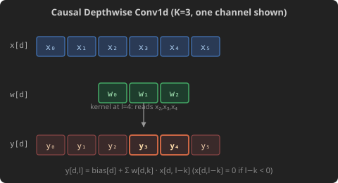

# Causal Depthwise Conv1d

LeetGPU · #90

[打开实现文件](../../practice/leetgpu/90/solution.cu) · [原始材料](../../references/LeetGPU/challenges/medium/90_causal_depthwise_conv1d/challenge.html)

Implement a **causal depthwise 1D convolution** over a batched sequence tensor `x` of shape `(B, L, D)`, producing an output of the same shape. In a depthwise convolution, each channel `d` is convolved independently using its own kernel `weight[d, :]` — there is no mixing across channels. The convolution is **causal**: output position `l` may only depend on input positions `0, 1, …, l` (past and present), never future positions. This operation is a key component of state-space models such as Mamba, where it is applied before the selective scan to mix local context within each feature channel.

 Formally, for each batch element `b`, sequence position `l`, and channel `d`:
 \[ \text{output}[b,\, l,\, d] = \text{bias}[d] + \sum_{k=0}^{K-1} \text{weight}[d,\, k] \cdot x[b,\, l - k,\, d] \]
 where positions `l − k < 0` are treated as zero (zero-pad the left boundary). The tensor layout is **channels-last**: `x[b, l, d]` is stored at offset `b × L × D + l × D + d`.

## Implementation Requirements

- The `solve` function signature must remain unchanged

- The result must be written into the `output` tensor

- Use only native features (external libraries are not permitted)

- Input positions before the start of the sequence (i.e. indices `l − k < 0`) must be treated as zero

## Example

With `B` = 1, `L` = 4, `D` = 2, `K` = 3:

~~~text

x      = [[[1.0, 2.0],    # l=0
           [3.0, 4.0],    # l=1
           [5.0, 6.0],    # l=2
           [7.0, 8.0]]]   # l=3   shape (1, 4, 2)

weight = [[ 1.0,  0.0, -1.0],   # channel d=0
          [ 1.0,  1.0,  1.0]]   # channel d=1   shape (2, 3)

bias   = [0.0, 0.0]

output = [[[1.0,  2.0],   # l=0: d0: 1*1=1          d1: 1*2=2
           [3.0,  6.0],   # l=1: d0: 3*1+1*0=3      d1: 4*1+2*1=6
           [4.0, 12.0],   # l=2: d0: 5*1+3*0+1*(-1)=4  d1: 6+4+2=12
           [4.0, 18.0]]]  # l=3: d0: 7*1+5*0+3*(-1)=4  d1: 8+6+4=18

~~~

## Constraints

- 1 ≤ `B` ≤ 16 (batch size)

- 1 ≤ `L` ≤ 8,192 (sequence length)

- 1 ≤ `D` ≤ 8,192 (number of channels)

- 1 ≤ `K` ≤ 8 (kernel size; typically 3 or 4 in practice)

- All tensors use 32-bit floating point

- Tensor `x` and `output` use channels-last layout: shape `(B, L, D)`

- Performance is measured with `B` = 8, `L` = 2,048, `D` = 4,096, `K` = 4

## 本地接口

~~~cpp
extern "C" void solve(const float* x, const float* weight, const float* bias, float* output, int B,
                      int L, int D, int K);
~~~

## 本地用例

~~~bash
./practice.sh cases leetgpu 90
./practice.sh test leetgpu 90
~~~

展开输入规格

~~~text
  #0 公开样例 · x (1, 4, 2) float32 · weight (2, 3) float32 · bias (2,) float32 · output (1, 4, 2) float32 · B 1 · L 4 · D 2 · K 3
  #1 公开功能用例 · x (1, 4, 2) float32 · weight (2, 3) float32 · bias (2,) float32 · output (1, 4, 2) float32 · B 1 · L 4 · D 2 · K 3
  #2 公开功能用例 · x (1, 1, 1) float32 · weight (1, 1) float32 · bias (1,) float32 · output (1, 1, 1) float32 · B 1 · L 1 · D 1 · K 1
  #3 公开功能用例 · x (1, 2, 1) float32 · weight (1, 2) float32 · bias (1,) float32 · output (1, 2, 1) float32 · B 1 · L 2 · D 1 · K 2
  #4 公开功能用例 · x (2, 3, 4) float32 · weight (4, 3) float32 · bias (4,) float32 · output (2, 3, 4) float32 · B 2 · L 3 · D 4 · K 3
  #5 公开功能用例 · x (1, 8, 4) float32 · weight (4, 3) float32 · bias (4,) float32 · output (1, 8, 4) float32 · B 1 · L 8 · D 4 · K 3
  #6 公开功能用例 · x (1, 16, 8) float32 · weight (8, 4) float32 · bias (8,) float32 · output (1, 16, 8) float32 · B 1 · L 16 · D 8 · K 4
  #7 公开功能用例 · x (2, 32, 16) float32 · weight (16, 4) float32 · bias (16,) float32 · output (2, 32, 16) float32 · B 2 · L 32 · D 16 · K 4
  #8 公开功能用例 · x (4, 64, 32) float32 · weight (32, 4) float32 · bias (32,) float32 · output (4, 64, 32) float32 · B 4 · L 64 · D 32 · K 4
  #9 公开功能用例 · x (3, 30, 12) float32 · weight (12, 3) float32 · bias (12,) float32 · output (3, 30, 12) float32 · B 3 · L 30 · D 12 · K 3
  #10 公开功能用例 · x (2, 100, 24) float32 · weight (24, 4) float32 · bias (24,) float32 · output (2, 100, 24) float32 · B 2 · L 100 · D 24 · K 4
  #11 公开功能用例 · x (2, 256, 128) float32 · weight (128, 4) float32 · bias (128,) float32 · output (2, 256, 128) float32 · B 2 · L 256 · D 128 · K 4
  #12 首个用例复验 · 原用例 #1 · 种子 2038 · 缓冲区守卫 · x (1, 4, 2) float32 · weight (2, 3) float32 · bias (2,) float32 · output (1, 4, 2) float32 · B 1 · L 4 · D 2 · K 3
  #13 中间用例复验 · 原用例 #6 · 种子 2039 · 缓冲区守卫 · x (1, 16, 8) float32 · weight (8, 4) float32 · bias (8,) float32 · output (1, 16, 8) float32 · B 1 · L 16 · D 8 · K 4
  #14 末尾用例复验 · 原用例 #11 · 种子 2040 · 缓冲区守卫 · x (2, 256, 128) float32 · weight (128, 4) float32 · bias (128,) float32 · output (2, 256, 128) float32 · B 2 · L 256 · D 128 · K 4
14 个功能用例，另有 1 个样例
~~~

