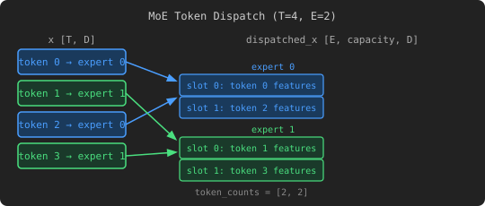

# MoE Token Dispatch

LeetGPU · #91

[打开实现文件](../../practice/leetgpu/91/solution.cu) · [原始材料](../../references/LeetGPU/challenges/medium/91_moe_token_dispatch/challenge.html)

In Mixture-of-Experts (MoE) neural networks, a router assigns each input token to one of `E` expert networks. Before those experts can execute in parallel, tokens must be *dispatched*: reorganized from their original sequence order into contiguous per-expert buffers. Given `T` tokens of feature dimension `D` and their expert assignments, fill each expert's slice of the output buffer with the tokens routed to that expert, preserving the original token order within each expert's group.

## Implementation Requirements

 Your `solve` function signature must not be changed. No external libraries beyond those already imported. Write outputs to `dispatched_x` and `token_counts` in place.

 For each expert `e`, `dispatched_x[e, :token_counts[e], :]` must contain exactly the tokens assigned to expert `e`, in the same relative order they appear in the original token sequence (i.e., token index ascending). Entries at positions `token_counts[e]` and beyond may be left as zero.

## Example

 Given `T` = 4 tokens of dimension `D` = 3 routed to `E` = 2 experts (capacity = 4):

Input tokens \(x\):

$$x = \begin{bmatrix} 1 & 0 & 0 \\ 0 & 1 & 0 \\ 0 & 0 & 1 \\ 1 & 1 & 0 \end{bmatrix}$$

Expert assignments:

~~~text
expert_idx = [0, 1, 0, 1]
~~~

Output token counts:

~~~text
token_counts = [2, 2]
~~~

\(\texttt{dispatched\_x}[0]\) — expert 0 receives tokens 0 and 2 (in original order):

$$\begin{bmatrix} 1 & 0 & 0 \\ 0 & 0 & 1 \end{bmatrix}$$

\(\texttt{dispatched\_x}[1]\) — expert 1 receives tokens 1 and 3 (in original order):

$$\begin{bmatrix} 0 & 1 & 0 \\ 1 & 1 & 0 \end{bmatrix}$$

## Constraints

- 1 ≤ `T` ≤ 65,536

- 1 ≤ `D` ≤ 2,048

- 2 ≤ `E` ≤ 64

- `capacity` = `T` (always sufficient for any routing assignment)

- All values in `expert_idx` are in the range [0, `E` − 1]

- `x` values are `float32`; `expert_idx` and `token_counts` are `int32`

- Performance is measured with `T` = 16,384, `D` = 512, `E` = 8

## 本地接口

~~~cpp
extern "C" void solve(const float* x, const int* expert_idx, float* dispatched_x, int* token_counts,
                      int T, int D, int E, int capacity);
~~~

## 本地用例

~~~bash
./practice.sh cases leetgpu 91
./practice.sh test leetgpu 91
~~~

展开输入规格

~~~text
  #0 公开样例 · x (4, 3) float32 · expert_idx (4,) int32 · dispatched_x (2, 4, 3) float32 · token_counts (2,) int32 · T 4 · D 3 · E 2 · capacity 4
  #1 公开功能用例 · x (1, 4) float32 · expert_idx (1,) int32 · dispatched_x (2, 1, 4) float32 · token_counts (2,) int32 · T 1 · D 4 · E 2 · capacity 1
  #2 公开功能用例 · x (2, 4) float32 · expert_idx (2,) int32 · dispatched_x (2, 2, 4) float32 · token_counts (2,) int32 · T 2 · D 4 · E 2 · capacity 2
  #3 公开功能用例 · x (4, 8) float32 · expert_idx (4,) int32 · dispatched_x (4, 4, 8) float32 · token_counts (4,) int32 · T 4 · D 8 · E 4 · capacity 4
  #4 公开功能用例 · x (8, 8) float32 · expert_idx (8,) int32 · dispatched_x (4, 8, 8) float32 · token_counts (4,) int32 · T 8 · D 8 · E 4 · capacity 8
  #5 公开功能用例 · x (32, 16) float32 · expert_idx (32,) int32 · dispatched_x (4, 32, 16) float32 · token_counts (4,) int32 · T 32 · D 16 · E 4 · capacity 32
  #6 公开功能用例 · x (256, 64) float32 · expert_idx (256,) int32 · dispatched_x (8, 256, 64) float32 · token_counts (8,) int32 · T 256 · D 64 · E 8 · capacity 256
  #7 公开功能用例 · x (30, 16) float32 · expert_idx (30,) int32 · dispatched_x (4, 30, 16) float32 · token_counts (4,) int32 · T 30 · D 16 · E 4 · capacity 30
  #8 公开功能用例 · x (100, 32) float32 · expert_idx (100,) int32 · dispatched_x (6, 100, 32) float32 · token_counts (6,) int32 · T 100 · D 32 · E 6 · capacity 100
  #9 公开功能用例 · x (1024, 128) float32 · expert_idx (1024,) int32 · dispatched_x (8, 1024, 128) float32 · token_counts (8,) int32 · T 1024 · D 128 · E 8 · capacity 1024
  #10 公开功能用例 · x (64, 32) float32 · expert_idx (64,) int32 · dispatched_x (4, 64, 32) float32 · token_counts (4,) int32 · T 64 · D 32 · E 4 · capacity 64
  #11 首个用例复验 · 原用例 #1 · 种子 2037 · 缓冲区守卫 · x (1, 4) float32 · expert_idx (1,) int32 · dispatched_x (2, 1, 4) float32 · token_counts (2,) int32 · T 1 · D 4 · E 2 · capacity 1
  #12 中间用例复验 · 原用例 #6 · 种子 2038 · 缓冲区守卫 · x (256, 64) float32 · expert_idx (256,) int32 · dispatched_x (8, 256, 64) float32 · token_counts (8,) int32 · T 256 · D 64 · E 8 · capacity 256
  #13 末尾用例复验 · 原用例 #10 · 种子 2039 · 缓冲区守卫 · x (64, 32) float32 · expert_idx (64,) int32 · dispatched_x (4, 64, 32) float32 · token_counts (4,) int32 · T 64 · D 32 · E 4 · capacity 64
13 个功能用例，另有 1 个样例
~~~

