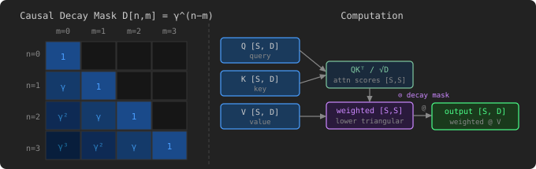

# Decaying Causal Attention

LeetGPU · #92

[打开实现文件](../../practice/leetgpu/92/solution.cu) · [原始材料](../../references/LeetGPU/challenges/medium/92_decaying_causal_attention/challenge.html)

Implement decaying causal attention. Given query matrix `Q`, key matrix `K`, and value matrix `V`, each of shape `seq_len × d_model`, and a scalar decay factor `gamma` ∈ (0, 1], compute the unnormalized causal attention output where position `n` attends to all past positions `m ≤ n` with weight `gamman−m`:

 \[ \text{output}[n] = \sum_{m=0}^{n} \gamma^{n-m} \cdot \frac{Q[n] \cdot K[m]}{\sqrt{d_{\text{model}}}} \cdot V[m] \]

 Unlike standard softmax attention, there is no normalization — the weights decay geometrically from the current position backward. This is the parallel form of the Retention mechanism (RetNet), used as a recurrence-friendly alternative to attention in sequence models.

## Implementation Requirements

- Implement the `solve` function; do not change its signature.

- Do not use external libraries beyond those provided.

- Write the result into `output`.

## Example

Example 1 — with `seq_len` = 2, `d_model` = 4, `gamma` = 0.5:

 \[ Q = \begin{bmatrix} 1 & 1 & 0 & 0 \\ 1 & 1 & 0 & 0 \end{bmatrix}, \quad K = \begin{bmatrix} 1 & 0 & 0 & 0 \\ 0 & 1 & 0 & 0 \end{bmatrix}, \quad V = \begin{bmatrix} 4 & 8 & 12 & 16 \\ 4 & 8 & 12 & 16 \end{bmatrix} \]

 Attention scores \(QK^\top / \sqrt{4}\): \[ A = \begin{bmatrix} 0.5 & 0.5 \\ 0.5 & 0.5 \end{bmatrix} \] Causal decay mask \(D_{nm} = 0.5^{n-m}\) for \(n \ge m\), else \(0\): \[ D = \begin{bmatrix} 1 & 0 \\ 0.5 & 1 \end{bmatrix} \] Weighted attention \(A \odot D\): \[ \begin{bmatrix} 0.5 & 0 \\ 0.25 & 0.5 \end{bmatrix} \] Output \((A \odot D)\,V\): \[ \text{output} = \begin{bmatrix} 2 & 4 & 6 & 8 \\ 3 & 6 & 9 & 12 \end{bmatrix} \]

## Constraints

- 1 ≤ `seq_len` ≤ 8,192

- 1 ≤ `d_model` ≤ 256

- 0 < `gamma` ≤ 1

- All tensors are `float32` on GPU.

- Performance is measured with `seq_len` = 4,096, `d_model` = 64

## 本地接口

~~~cpp
extern "C" void solve(const float* Q, const float* K, const float* V, float* output, int seq_len,
                      int d_model, float gamma);
~~~

## 本地用例

~~~bash
./practice.sh cases leetgpu 92
./practice.sh test leetgpu 92
~~~

展开输入规格

~~~text
  #0 公开样例 · Q (2, 4) float32 · K (2, 4) float32 · V (2, 4) float32 · output (2, 4) float32 · seq_len 2 · d_model 4 · gamma 0.5
  #1 公开功能用例 · Q (1, 4) float32 · K (1, 4) float32 · V (1, 4) float32 · output (1, 4) float32 · seq_len 1 · d_model 4 · gamma 0.9
  #2 公开功能用例 · Q (2, 4) float32 · K (2, 4) float32 · V (2, 4) float32 · output (2, 4) float32 · seq_len 2 · d_model 4 · gamma 0.5
  #3 公开功能用例 · Q (4, 8) float32 · K (4, 8) float32 · V (4, 8) float32 · output (4, 8) float32 · seq_len 4 · d_model 8 · gamma 1.0
  #4 公开功能用例 · Q (4, 8) float32 · K (4, 8) float32 · V (4, 8) float32 · output (4, 8) float32 · seq_len 4 · d_model 8 · gamma 0.1
  #5 公开功能用例 · Q (8, 16) float32 · K (8, 16) float32 · V (8, 16) float32 · output (8, 16) float32 · seq_len 8 · d_model 16 · gamma 0.9
  #6 公开功能用例 · Q (16, 16) float32 · K (16, 16) float32 · V (16, 16) float32 · output (16, 16) float32 · seq_len 16 · d_model 16 · gamma 0.8
  #7 公开功能用例 · Q (32, 32) float32 · K (32, 32) float32 · V (32, 32) float32 · output (32, 32) float32 · seq_len 32 · d_model 32 · gamma 0.9
  #8 公开功能用例 · Q (64, 64) float32 · K (64, 64) float32 · V (64, 64) float32 · output (64, 64) float32 · seq_len 64 · d_model 64 · gamma 0.8
  #9 公开功能用例 · Q (30, 32) float32 · K (30, 32) float32 · V (30, 32) float32 · output (30, 32) float32 · seq_len 30 · d_model 32 · gamma 0.95
  #10 公开功能用例 · Q (100, 64) float32 · K (100, 64) float32 · V (100, 64) float32 · output (100, 64) float32 · seq_len 100 · d_model 64 · gamma 0.9
  #11 首个用例复验 · 原用例 #1 · 种子 2037 · 缓冲区守卫 · Q (1, 4) float32 · K (1, 4) float32 · V (1, 4) float32 · output (1, 4) float32 · seq_len 1 · d_model 4 · gamma 0.9
  #12 中间用例复验 · 原用例 #6 · 种子 2038 · 缓冲区守卫 · Q (16, 16) float32 · K (16, 16) float32 · V (16, 16) float32 · output (16, 16) float32 · seq_len 16 · d_model 16 · gamma 0.8
  #13 末尾用例复验 · 原用例 #10 · 种子 2039 · 缓冲区守卫 · Q (100, 64) float32 · K (100, 64) float32 · V (100, 64) float32 · output (100, 64) float32 · seq_len 100 · d_model 64 · gamma 0.9
13 个功能用例，另有 1 个样例
~~~

