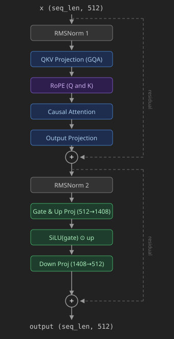

# Llama Transformer Block

LeetGPU · #93

[打开实现文件](../../practice/leetgpu/93/solution.cu) · [原始材料](../../references/LeetGPU/challenges/hard/93_llama_transformer_block/challenge.html)

Implement a single Llama-style transformer decoder block. Given an input tensor \(x\) of shape `(seq_len, 512)`, a packed weight buffer, and precomputed RoPE tables, compute the output using pre-norm architecture with Grouped Query Attention (GQA), Rotary Position Embeddings (RoPE), and a SwiGLU feed-forward network.

 The block follows Llama's **pre-norm** architecture. Unlike GPT-2, it uses **RMSNorm** (no mean subtraction, no additive bias), **Grouped Query Attention** with 8 query heads and 2 key/value heads, **Rotary Position Embeddings** applied to Q and K, and a **SwiGLU** feed-forward network. None of the linear projections have bias terms.
 \[ \begin{aligned} x' &= x + \text{Attn}\!\left(\text{RMSNorm}_1(x),\; \cos,\; \sin\right) \\[4pt] \text{output} &= x' + \text{FFN}\!\left(\text{RMSNorm}_2(x')\right) \end{aligned} \]
The sub-operations in detail:
 \[ \begin{aligned} \text{RMSNorm}(z, w) &= \frac{z}{\sqrt{\frac{1}{d}\sum_i z_i^2 + \varepsilon}} \odot w, \quad \varepsilon = 10^{-5} \\[8pt] Q &= \text{RMSNorm}_1(x)\, W_Q^\top \in \mathbb{R}^{T \times 512}, \quad \text{reshape to } (T, 8, 64) \\[4pt] K &= \text{RMSNorm}_1(x)\, W_K^\top \in \mathbb{R}^{T \times 128}, \quad \text{reshape to } (T, 2, 64) \\[4pt] V &= \text{RMSNorm}_1(x)\, W_V^\top \in \mathbb{R}^{T \times 128}, \quad \text{reshape to } (T, 2, 64) \\[8pt] \text{RoPE}(q, \cos, \sin) &: \quad [q_1 \mid q_2] \mapsto [q_1 \odot \cos - q_2 \odot \sin \mid q_1 \odot \sin + q_2 \odot \cos] \\[4pt] &\quad q_1 = q[\ldots, {:}32],\; q_2 = q[\ldots, {32:}] \\[8pt] \text{GQA} &: \text{repeat } K,V \text{ along head dim } 4\times \text{ to match 8 Q heads} \\[4pt] \text{head}_i &= \text{softmax}\!\left(\frac{Q_i K_i^\top}{\sqrt{64}} + M_{\text{causal}}\right) V_i \\[8pt] \text{Attn}(x) &= \text{Concat}(\text{head}_1, \ldots, \text{head}_8)\; W_O^\top \\[8pt] \text{FFN}(z) &= \bigl(\text{SiLU}(z\, W_{\text{gate}}^\top) \odot z\, W_{\text{up}}^\top\bigr)\; W_{\text{down}}^\top \end{aligned} \]
where \(M_{\text{causal}}\) is the upper-triangular causal mask (\(-\infty\) above the diagonal) and \(\text{SiLU}(x) = x \cdot \sigma(x)\).

## Implementation Requirements

- Use only native features (external libraries are not permitted)

- The `solve` function signature must remain unchanged

- The final result must be stored in the `output` tensor

- RMSNorm uses \(\varepsilon = 10^{-5}\), no additive bias

- Apply causal masking: position \(i\) attends only to positions \(\le i\)

- Repeat K and V heads \(4\times\) (GQA groups) before computing attention

- `cos` and `sin` have shape `(seq_len, 32)` — apply them to both Q and K heads independently

## Weight Layout

All parameters are packed into a single contiguous `weights` buffer (2,819,072 floats) in the order below. All 2-D matrices are stored row-major with shape `(out_dim, in_dim)`. There are no bias terms.

<table style="border-collapse:separate; border-spacing:16px 6px;">
  <tr>
    <th style="text-align:left;">Parameter</th>
    <th style="text-align:left;">Shape</th>
    <th style="text-align:right;">Size</th>
    <th style="text-align:right;">Offset</th>
  </tr>
  <tr>
    <td>\(w_1\) (RMSNorm 1 scale)</td>
    <td>(512,)</td>
    <td style="text-align:right;">512</td>
    <td style="text-align:right;">0</td>
  </tr>
  <tr>
    <td>\(W_Q\)</td>
    <td>(512, 512)</td>
    <td style="text-align:right;">262,144</td>
    <td style="text-align:right;">512</td>
  </tr>
  <tr>
    <td>\(W_K\)</td>
    <td>(128, 512)</td>
    <td style="text-align:right;">65,536</td>
    <td style="text-align:right;">262,656</td>
  </tr>
  <tr>
    <td>\(W_V\)</td>
    <td>(128, 512)</td>
    <td style="text-align:right;">65,536</td>
    <td style="text-align:right;">328,192</td>
  </tr>
  <tr>
    <td>\(W_O\)</td>
    <td>(512, 512)</td>
    <td style="text-align:right;">262,144</td>
    <td style="text-align:right;">393,728</td>
  </tr>
  <tr>
    <td>\(w_2\) (RMSNorm 2 scale)</td>
    <td>(512,)</td>
    <td style="text-align:right;">512</td>
    <td style="text-align:right;">655,872</td>
  </tr>
  <tr>
    <td>\(W_{\text{gate}}\)</td>
    <td>(1408, 512)</td>
    <td style="text-align:right;">720,896</td>
    <td style="text-align:right;">656,384</td>
  </tr>
  <tr>
    <td>\(W_{\text{up}}\)</td>
    <td>(1408, 512)</td>
    <td style="text-align:right;">720,896</td>
    <td style="text-align:right;">1,377,280</td>
  </tr>
  <tr>
    <td>\(W_{\text{down}}\)</td>
    <td>(512, 1408)</td>
    <td style="text-align:right;">720,896</td>
    <td style="text-align:right;">2,098,176</td>
  </tr>
</table>

## Example

With `seq_len` = 4, `x` drawn uniformly from [−1, 1], and randomly initialized weights:

~~~text

Input:  x.shape       = (4, 512)       # 4 token hidden states
        weights.shape = (2,819,072,)   # packed weight buffer
        cos.shape     = (4, 32)        # precomputed RoPE cosines
        sin.shape     = (4, 32)        # precomputed RoPE sines
        seq_len       = 4
Output: output.shape  = (4, 512)       # transformed token hidden states

~~~

## Constraints

- `d_model` = 512, `n_q_heads` = 8, `n_kv_heads` = 2, `head_dim` = 64, `ffn_hidden` = 1,408

- 1 ≤ `seq_len` ≤ 4,096

- All tensors use 32-bit floating point

- Performance is measured with `seq_len` = 2,048

## 本地接口

~~~cpp
extern "C" void solve(const float* x, float* output, const float* weights, const float* cos,
                      const float* sin, int seq_len);
~~~

## 本地用例

~~~bash
./practice.sh cases leetgpu 93
./practice.sh test leetgpu 93
~~~

展开输入规格

~~~text
  #0 公开样例 · x (4, 512) float32 · output (4, 512) float32 · weights (2819072,) float32 · cos (4, 32) float32 · sin (4, 32) float32 · seq_len 4
  #1 公开功能用例 · x (1, 512) float32 · output (1, 512) float32 · weights (2819072,) float32 · cos (1, 32) float32 · sin (1, 32) float32 · seq_len 1
  #2 公开功能用例 · x (4, 512) float32 · output (4, 512) float32 · weights (2819072,) float32 · cos (4, 32) float32 · sin (4, 32) float32 · seq_len 4
  #3 公开功能用例 · x (2, 512) float32 · output (2, 512) float32 · weights (2819072,) float32 · cos (2, 32) float32 · sin (2, 32) float32 · seq_len 2
  #4 公开功能用例 · x (4, 512) float32 · output (4, 512) float32 · weights (2819072,) float32 · cos (4, 32) float32 · sin (4, 32) float32 · seq_len 4
  #5 公开功能用例 · x (16, 512) float32 · output (16, 512) float32 · weights (2819072,) float32 · cos (16, 32) float32 · sin (16, 32) float32 · seq_len 16
  #6 公开功能用例 · x (64, 512) float32 · output (64, 512) float32 · weights (2819072,) float32 · cos (64, 32) float32 · sin (64, 32) float32 · seq_len 64
  #7 公开功能用例 · x (30, 512) float32 · output (30, 512) float32 · weights (2819072,) float32 · cos (30, 32) float32 · sin (30, 32) float32 · seq_len 30
  #8 公开功能用例 · x (100, 512) float32 · output (100, 512) float32 · weights (2819072,) float32 · cos (100, 32) float32 · sin (100, 32) float32 · seq_len 100
  #9 公开功能用例 · x (128, 512) float32 · output (128, 512) float32 · weights (2819072,) float32 · cos (128, 32) float32 · sin (128, 32) float32 · seq_len 128
  #10 公开功能用例 · x (256, 512) float32 · output (256, 512) float32 · weights (2819072,) float32 · cos (256, 32) float32 · sin (256, 32) float32 · seq_len 256
  #11 首个用例复验 · 原用例 #1 · 种子 2037 · 缓冲区守卫 · x (1, 512) float32 · output (1, 512) float32 · weights (2819072,) float32 · cos (1, 32) float32 · sin (1, 32) float32 · seq_len 1
  #12 中间用例复验 · 原用例 #6 · 种子 2038 · 缓冲区守卫 · x (64, 512) float32 · output (64, 512) float32 · weights (2819072,) float32 · cos (64, 32) float32 · sin (64, 32) float32 · seq_len 64
  #13 末尾用例复验 · 原用例 #10 · 种子 2039 · 缓冲区守卫 · x (256, 512) float32 · output (256, 512) float32 · weights (2819072,) float32 · cos (256, 32) float32 · sin (256, 32) float32 · seq_len 256
13 个功能用例，另有 1 个样例
~~~

