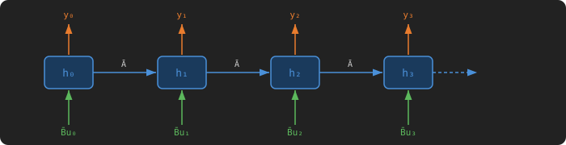

# SSM Selective Scan

LeetGPU · #94

[打开实现文件](../../practice/leetgpu/94/solution.cu) · [原始材料](../../references/LeetGPU/challenges/medium/94_ssm_selective_scan/challenge.html)

Implement the forward pass of a State Space Model (SSM) selective scan, the core operation in Mamba-style sequence models. Given an input sequence `u`, time-step parameters `delta`, state-transition matrix `A`, input projection `B`, output projection `C`, and skip-connection weights `skip`, compute the output sequence `y` in float32.

## Implementation Requirements

 Implement the function `solve(u, delta, A, B, C, skip, y, batch, seq_len, d_model, d_state)` with the signature unchanged. Do not use external libraries beyond the allowed framework. Write the result into the pre-allocated output tensor `y`.

 For each batch `b`, position `t`, and channel `d`, the computation is:

 \[ \bar{A}_{b,t,d,n} = \exp(\Delta_{b,t,d} \cdot A_{d,n}) \] \[ \bar{B}_{b,t,d,n} = \Delta_{b,t,d} \cdot B_{b,t,n} \] \[ h_{b,t,d,n} = \bar{A}_{b,t,d,n} \cdot h_{b,t-1,d,n} + \bar{B}_{b,t,d,n} \cdot u_{b,t,d} \] \[ y_{b,t,d} = \sum_{n} C_{b,t,n} \cdot h_{b,t,d,n} + \text{skip}_d \cdot u_{b,t,d} \]

 The initial hidden state \(h_{b,-1,d,n} = 0\) for all \(b, d, n\). All channels `d` are independent: they share the same `B` and `C` projections but have separate state-transition rows in `A`.

## Example

~~~text

Input:
  u     = [[[1.0, 0.0], [0.0, 1.0], [1.0, 1.0], [0.0, 0.0]]]  shape (1,4,2)
  delta = [[[1.0, 1.0], [1.0, 1.0], [1.0, 1.0], [1.0, 1.0]]]  shape (1,4,2)
  A     = [[-0.5, -1.0], [-0.5, -1.0]]                         shape (2,2)
  B     = [[[1.0, 0.0], [0.0, 1.0], [1.0, 1.0], [0.5, 0.5]]]  shape (1,4,2)
  C     = [[[1.0, 0.0], [0.0, 1.0], [1.0, 1.0], [0.5, 0.5]]]  shape (1,4,2)
  skip  = [0.0, 0.0]                                            shape (2,)
  batch=1, seq_len=4, d_model=2, d_state=2

Derivation (delta=1 everywhere, so A_bar_dn = exp(A_dn)):
  A_bar[d=0] = [exp(-0.5), exp(-1.0)] ≈ [0.607, 0.368]
  A_bar[d=1] = [exp(-0.5), exp(-1.0)] ≈ [0.607, 0.368]

  Hidden state h has shape (d_model=2, d_state=2); initial h = zeros.
  t=0: h = [[1.000, 0.000], [0.000, 0.000]]  →  y[0,0] = [1.000, 0.000]
  t=1: h = [[0.607, 0.000], [0.000, 1.000]]  →  y[0,1] = [0.000, 1.000]
  t=2: h = [[1.368, 1.000], [1.000, 1.368]]  →  y[0,2] = [2.368, 2.368]
  t=3: h = [[0.830, 0.368], [0.607, 0.503]]  →  y[0,3] = [0.599, 0.555]

Output:
  y = [[[1.000, 0.000], [0.000, 1.000], [2.368, 2.368], [0.599, 0.555]]]

~~~

## Constraints

- 1 ≤ `batch` ≤ 16

- 1 ≤ `seq_len` ≤ 8,192

- 1 ≤ `d_model` ≤ 2,048

- 1 ≤ `d_state` ≤ 64

- All entries of `delta` are positive

- All entries of `A` are negative (ensuring `A_bar ∈ (0, 1)`)

- All tensors are float32 on the GPU

- Performance is measured with `batch` = 4, `seq_len` = 4,096, `d_model` = 512, `d_state` = 16

## 本地接口

~~~cpp
extern "C" void solve(const float* u, const float* delta, const float* A, const float* B,
                      const float* C, const float* skip, float* y, int batch, int seq_len,
                      int d_model, int d_state);
~~~

## 本地用例

~~~bash
./practice.sh cases leetgpu 94
./practice.sh test leetgpu 94
~~~

展开输入规格

~~~text
  #0 公开样例 · u (1, 4, 2) float32 · delta (1, 4, 2) float32 · A (2, 2) float32 · B (1, 4, 2) float32 · C (1, 4, 2) float32 · skip (2,) float32 · y (1, 4, 2) float32 · batch 1 · seq_len 4 · d_model 2 · d_state 2
  #1 公开功能用例 · u (1, 1, 1) float32 · delta (1, 1, 1) float32 · A (1, 4) float32 · B (1, 1, 4) float32 · C (1, 1, 4) float32 · skip (1,) float32 · y (1, 1, 1) float32 · batch 1 · seq_len 1 · d_model 1 · d_state 4
  #2 公开功能用例 · u (1, 2, 2) float32 · delta (1, 2, 2) float32 · A (2, 2) float32 · B (1, 2, 2) float32 · C (1, 2, 2) float32 · skip (2,) float32 · y (1, 2, 2) float32 · batch 1 · seq_len 2 · d_model 2 · d_state 2
  #3 公开功能用例 · u (1, 4, 4) float32 · delta (1, 4, 4) float32 · A (4, 4) float32 · B (1, 4, 4) float32 · C (1, 4, 4) float32 · skip (4,) float32 · y (1, 4, 4) float32 · batch 1 · seq_len 4 · d_model 4 · d_state 4
  #4 公开功能用例 · u (2, 4, 4) float32 · delta (2, 4, 4) float32 · A (4, 4) float32 · B (2, 4, 4) float32 · C (2, 4, 4) float32 · skip (4,) float32 · y (2, 4, 4) float32 · batch 2 · seq_len 4 · d_model 4 · d_state 4
  #5 公开功能用例 · u (2, 16, 8) float32 · delta (2, 16, 8) float32 · A (8, 4) float32 · B (2, 16, 4) float32 · C (2, 16, 4) float32 · skip (8,) float32 · y (2, 16, 8) float32 · batch 2 · seq_len 16 · d_model 8 · d_state 4
  #6 公开功能用例 · u (2, 64, 16) float32 · delta (2, 64, 16) float32 · A (16, 8) float32 · B (2, 64, 8) float32 · C (2, 64, 8) float32 · skip (16,) float32 · y (2, 64, 16) float32 · batch 2 · seq_len 64 · d_model 16 · d_state 8
  #7 公开功能用例 · u (2, 30, 12) float32 · delta (2, 30, 12) float32 · A (12, 4) float32 · B (2, 30, 4) float32 · C (2, 30, 4) float32 · skip (12,) float32 · y (2, 30, 12) float32 · batch 2 · seq_len 30 · d_model 12 · d_state 4
  #8 公开功能用例 · u (3, 100, 24) float32 · delta (3, 100, 24) float32 · A (24, 8) float32 · B (3, 100, 8) float32 · C (3, 100, 8) float32 · skip (24,) float32 · y (3, 100, 24) float32 · batch 3 · seq_len 100 · d_model 24 · d_state 8
  #9 公开功能用例 · u (2, 128, 32) float32 · delta (2, 128, 32) float32 · A (32, 16) float32 · B (2, 128, 16) float32 · C (2, 128, 16) float32 · skip (32,) float32 · y (2, 128, 32) float32 · batch 2 · seq_len 128 · d_model 32 · d_state 16
  #10 公开功能用例 · u (4, 256, 64) float32 · delta (4, 256, 64) float32 · A (64, 16) float32 · B (4, 256, 16) float32 · C (4, 256, 16) float32 · skip (64,) float32 · y (4, 256, 64) float32 · batch 4 · seq_len 256 · d_model 64 · d_state 16
  #11 首个用例复验 · 原用例 #1 · 种子 2037 · 缓冲区守卫 · u (1, 1, 1) float32 · delta (1, 1, 1) float32 · A (1, 4) float32 · B (1, 1, 4) float32 · C (1, 1, 4) float32 · skip (1,) float32 · y (1, 1, 1) float32 · batch 1 · seq_len 1 · d_model 1 · d_state 4
  #12 中间用例复验 · 原用例 #6 · 种子 2038 · 缓冲区守卫 · u (2, 64, 16) float32 · delta (2, 64, 16) float32 · A (16, 8) float32 · B (2, 64, 8) float32 · C (2, 64, 8) float32 · skip (16,) float32 · y (2, 64, 16) float32 · batch 2 · seq_len 64 · d_model 16 · d_state 8
  #13 末尾用例复验 · 原用例 #10 · 种子 2039 · 缓冲区守卫 · u (4, 256, 64) float32 · delta (4, 256, 64) float32 · A (64, 16) float32 · B (4, 256, 16) float32 · C (4, 256, 16) float32 · skip (64,) float32 · y (4, 256, 64) float32 · batch 4 · seq_len 256 · d_model 64 · d_state 16
13 个功能用例，另有 1 个样例
~~~

