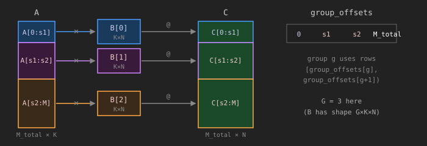

# Grouped GEMM

LeetGPU · #99

[打开实现文件](../../practice/leetgpu/99/solution.cu) · [原始材料](../../references/LeetGPU/challenges/medium/99_grouped_gemm/challenge.html)

Implement a Grouped General Matrix Multiplication. The input matrix `A` of shape `M_total × K` is partitioned into `G` contiguous row groups whose boundaries are given by the cumulative array `group_offsets` of length `G + 1`. Each group `g` has its own weight matrix `B[g]` of shape `K × N`. For every group, multiply the rows assigned to it by that group's weight matrix and write the result into the corresponding rows of `C`.

 Formally, for every group `g` in `0, 1, ..., G-1`, let `s = group_offsets[g]` and `e = group_offsets[g+1]`. Then `C[s:e] = A[s:e] × B[g]`. A group may be empty (`s == e`), in which case no rows are written for that group.

 This pattern is the core building block of Mixture-of-Experts (MoE) inference: after a router has dispatched tokens to experts, each expert holds a variable number of tokens that all share the same weight matrix. A single grouped GEMM computes every expert's projection in one launch.

## Implementation Requirements

- Implement the `solve` function; do not change its signature.

- External libraries are not permitted.

- Write the result into `C`.

## Examples

Example 1: `G` = 2, `M_total` = 4, `K` = 2, `N` = 3, `group_offsets` = `[0, 2, 4]`

 \[ A = \begin{bmatrix} 1 & 2 \\ 3 & 4 \\ 5 & 6 \\ 7 & 8 \end{bmatrix},\quad B[0] = \begin{bmatrix} 1 & 0 & 1 \\ 0 & 1 & 0 \end{bmatrix},\quad B[1] = \begin{bmatrix} 1 & 1 & 0 \\ 1 & 1 & 1 \end{bmatrix} \]

 \[ C = \begin{bmatrix} 1 & 2 & 1 \\ 3 & 4 & 3 \\ 11 & 11 & 6 \\ 15 & 15 & 8 \end{bmatrix} \]

 Group 0 occupies rows `[0, 2)` of `A`, so `C[0:2] = A[0:2] × B[0]`. Group 1 occupies rows `[2, 4)`, so `C[2:4] = A[2:4] × B[1]`.

## Constraints

- 1 ≤ `G` ≤ 64 (number of groups)

- 1 ≤ `M_total` ≤ 16,384 (total rows across all groups)

- 1 ≤ `K`, `N` ≤ 4,096

- `group_offsets[0]` = 0, `group_offsets[G]` = `M_total`, and `group_offsets` is non-decreasing

- A group may be empty (`group_offsets[g+1]` = `group_offsets[g]`); in that case nothing is written for that group

- `A`, `B`, and `C` are 32-bit floats; `group_offsets` is 32-bit integer

- Values of `A` and `B` are in the range [-1, 1]

- All tensors are stored on the GPU

- Performance is measured with `G` = 8, `M_total` = 8,192, `K` = 1,024, `N` = 2,048

## 本地接口

~~~cpp
extern "C" void solve(const float* A, const float* B, const int* group_offsets, float* C, int G,
                      int M_total, int K, int N);
~~~

## 本地用例

~~~bash
./practice.sh cases leetgpu 99
./practice.sh test leetgpu 99
~~~

展开输入规格

~~~text
  #0 公开样例 · A (4, 2) float32 · B (2, 2, 3) float32 · group_offsets (3,) int32 · C (4, 3) float32 · G 2 · M_total 4 · K 2 · N 3
  #1 公开功能用例 · A (4, 2) float32 · B (2, 2, 3) float32 · group_offsets (3,) int32 · C (4, 3) float32 · G 2 · M_total 4 · K 2 · N 3
  #2 公开功能用例 · A (1, 4) float32 · B (1, 4, 4) float32 · group_offsets (2,) int32 · C (1, 4) float32 · G 1 · M_total 1 · K 4 · N 4
  #3 公开功能用例 · A (8, 16) float32 · B (1, 16, 16) float32 · group_offsets (2,) int32 · C (8, 16) float32 · G 1 · M_total 8 · K 16 · N 16
  #4 公开功能用例 · A (6, 8) float32 · B (2, 8, 8) float32 · group_offsets (3,) int32 · C (6, 8) float32 · G 2 · M_total 6 · K 8 · N 8
  #5 公开功能用例 · A (6, 8) float32 · B (5, 8, 8) float32 · group_offsets (6,) int32 · C (6, 8) float32 · G 5 · M_total 6 · K 8 · N 8
  #6 公开功能用例 · A (64, 32) float32 · B (4, 32, 32) float32 · group_offsets (5,) int32 · C (64, 32) float32 · G 4 · M_total 64 · K 32 · N 32
  #7 公开功能用例 · A (100, 64) float32 · B (8, 64, 64) float32 · group_offsets (9,) int32 · C (100, 64) float32 · G 8 · M_total 100 · K 64 · N 64
  #8 公开功能用例 · A (31, 33) float32 · B (3, 33, 27) float32 · group_offsets (4,) int32 · C (31, 27) float32 · G 3 · M_total 31 · K 33 · N 27
  #9 公开功能用例 · A (60, 16) float32 · B (3, 16, 16) float32 · group_offsets (4,) int32 · C (60, 16) float32 · G 3 · M_total 60 · K 16 · N 16
  #10 公开功能用例 · A (2057, 128) float32 · B (8, 128, 512) float32 · group_offsets (9,) int32 · C (2057, 512) float32 · G 8 · M_total 2057 · K 128 · N 512
  #11 首个用例复验 · 原用例 #1 · 种子 2037 · 缓冲区守卫 · A (4, 2) float32 · B (2, 2, 3) float32 · group_offsets (3,) int32 · C (4, 3) float32 · G 2 · M_total 4 · K 2 · N 3
  #12 中间用例复验 · 原用例 #6 · 种子 2038 · 缓冲区守卫 · A (64, 32) float32 · B (4, 32, 32) float32 · group_offsets (5,) int32 · C (64, 32) float32 · G 4 · M_total 64 · K 32 · N 32
  #13 末尾用例复验 · 原用例 #10 · 种子 2039 · 缓冲区守卫 · A (2057, 128) float32 · B (8, 128, 512) float32 · group_offsets (9,) int32 · C (2057, 512) float32 · G 8 · M_total 2057 · K 128 · N 512
13 个功能用例，另有 1 个样例
~~~

